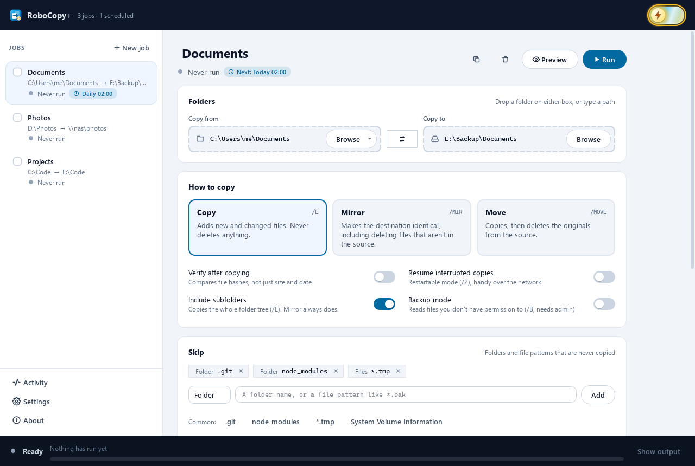
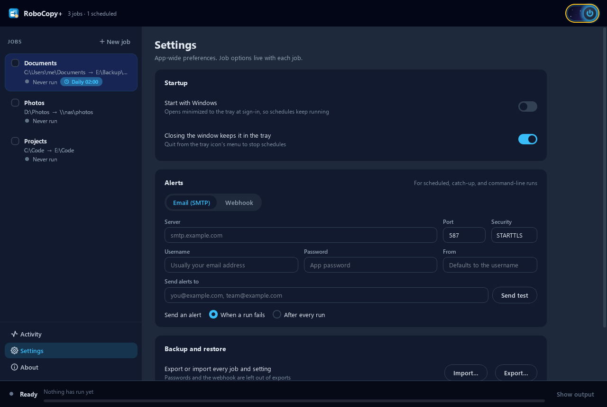

# RoboCopy+

A friendlier way to run Windows' built-in `robocopy`. Save each backup as a named job, run it with live progress, schedule it, verify the copy, and get an email or webhook alert when an unattended run fails.

This repository hosts the downloads. Get the latest version from **[Releases](../../releases/latest)**.



## Download and run

1. Download `RoboCopyPlus.exe` from the [latest release](../../releases/latest).
2. Run it. There's no installer; it's a single file you can keep anywhere.

**Requirements:** Windows 10 or 11, 64-bit. `robocopy.exe` ships with Windows, so there's nothing else to install.

**"Windows protected your PC"?** The exe isn't code-signed yet, so SmartScreen may warn about it the first time. Click **More info**, then **Run anyway**. To confirm your download is the one published here, compare its SHA-256 checksum with `SHA256SUMS.txt` on the release page:

```powershell
Get-FileHash .\RoboCopyPlus.exe -Algorithm SHA256
```

## Features

- **Jobs.** Each job keeps its own folders, options, and schedule, and shows when it last ran and whether it worked.
- **Three ways to copy.** Copy adds new and changed files and never deletes. Mirror makes the destination identical. Move copies, then deletes the originals. Mirror and Move ask before they run.
- **Skip rules.** Skip folders or file patterns (one click for `.git`, `node_modules`, `*.tmp`, and more), or skip files by age or size.
- **Live output and progress,** with a plain-English summary of every run, plus **Preview** to see what would change without copying anything.
- **Run in order.** Tick several jobs and run them back to back.
- **Hash verification (optional).** Compares file contents after copying, so silent corruption doesn't go unnoticed.
- **Schedules.** Daily, weekly, every few hours, or once. Runs that were missed while the PC was off are offered on the next launch.
- **Alerts** by email (any SMTP server) or webhook (Slack, Discord, Teams, and others) for scheduled and unattended runs.
- **Activity** history with the full log of every run.
- **Light and dark themes,** a system tray icon, and an optional Start with Windows setting so schedules keep running.



## Command line

```powershell
RoboCopyPlus.exe --minimized               # start in the system tray
RoboCopyPlus.exe --job "Nightly" --run     # run a saved job with no window, then exit
```

`--run` exits with robocopy's exit code, plus 8 if verification found mismatches, so scripts can detect a failed copy.

## Alerts

Set alerts up under **Settings > Alerts**. Use **Send test** to check them before relying on them.

- **Email:** enter your mail provider's SMTP server, port, and security setting. Many providers (Gmail and Outlook.com, for example) require an *app password* rather than your normal password when two-step verification is on. Create one in your account's security settings.
- **Webhook:** paste the incoming-webhook URL from Slack, Discord, Teams, or any service that accepts a JSON POST.

Your SMTP password and webhook URL are stored encrypted for your Windows account, and they're never included when you export your settings.

## Your data

Everything RoboCopy+ saves (jobs, settings, run history, and run logs) lives in `%APPDATA%\RoboCopy+` on your PC. Nothing is sent anywhere except the alerts you set up yourself.

To uninstall, quit RoboCopy+ from its tray icon, turn off **Start with Windows** in Settings if you'd turned it on, then delete the exe and, if you like, the `%APPDATA%\RoboCopy+` folder.

## Notes

- Schedules only run while RoboCopy+ is open. It can sit in the system tray, and Start with Windows opens it at sign-in.
- Backup mode (`/B`) needs RoboCopy+ to be run as administrator.

© 2026 Steven Klinck
